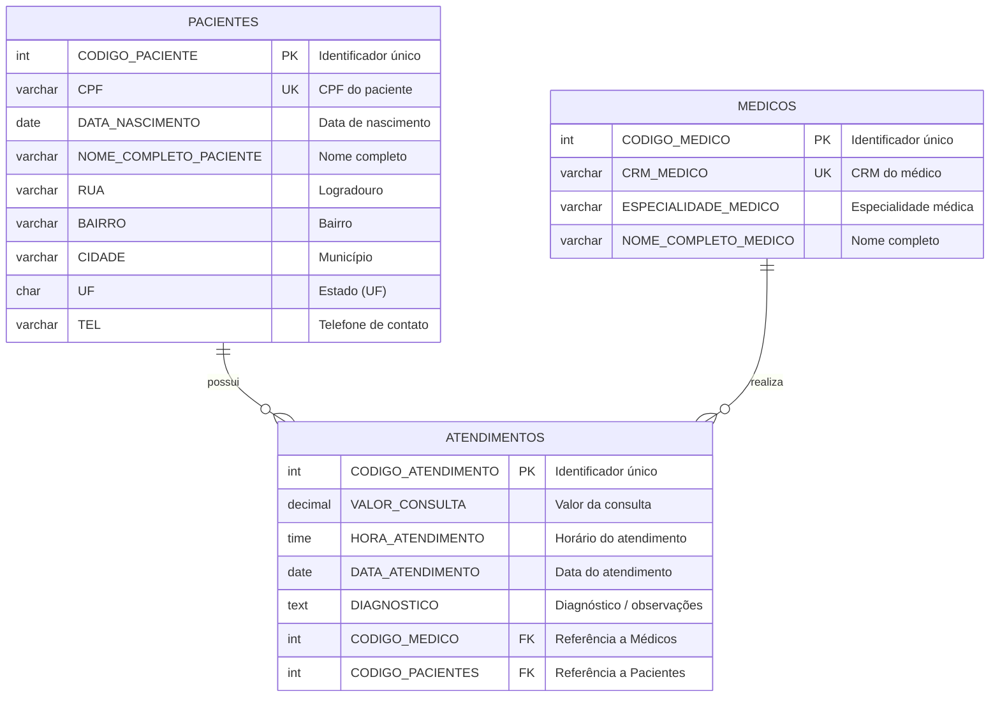

# 🏥 Banco de Dados Hospitalar

Projeto de modelagem e implementação de banco de dados relacional para gerenciamento de atendimentos hospitalares, controle de pacientes, médicos e consultas.

---

## 📌 Sobre o Projeto

Este repositório contém o script SQL para criação e estruturação do banco de dados `hospital`. O sistema foi projetado para registrar informações essenciais de pacientes e médicos, além de vincular consultas médicas (atendimentos) realizadas, mantendo a integridade referencial por meio de chaves estrangeiras.

---

## 🗂️ Estrutura do Banco de Dados

### Diagrama Entidade-Relacionamento (DER)



---

## 📋 Detalhamento das Tabelas

### 1. `pacientes`
Armazena os dados cadastrais e endereço dos pacientes.
* **`CODIGO_PACIENTE`**: `INT` (Chave Primária, Not Null, Unique)
* **`CPF`**: `VARCHAR(12)` (Not Null, Unique)
* **`DATA_NASCIMENTO`**: `DATE` (Not Null)
* **`NOME_COMPLETO_PACIENTE`**: `VARCHAR(45)` (Not Null)
* **`RUA`**: `VARCHAR(45)`
* **`BAIRRO`**: `VARCHAR(45)`
* **`CIDADE`**: `VARCHAR(45)`
* **`UF`**: `CHAR(2)`
* **`TEL`**: `VARCHAR(15)`

### 2. `medicos`
Armazena os dados dos profissionais de saúde cadastrados.
* **`CODIGO_MEDICO`**: `INT` (Chave Primária, Not Null, Unique)
* **`CRM_MEDICO`**: `VARCHAR(50)` (Not Null, Unique)
* **`ESPECIALIDADE_MEDICO`**: `VARCHAR(45)` (Not Null)
* **`NOME_COMPLETO_MEDICO`**: `VARCHAR(50)` (Not Null)

### 3. `atendimentos`
Registra as consultas médicas realizadas, relacionando o médico responsável e o paciente atendido.
* **`CODIGO_ATENDIMENTO`**: `INT` (Chave Primária, Not Null, Unique)
* **`VALOR_CONSULTA`**: `DECIMAL(10,2)`
* **`HORA_ATENDIMENTO`**: `TIME`
* **`DATA_ATENDIMENTO`**: `DATE`
* **`DIAGNOSTICO`**: `TEXT`
* **`CODIGO_MEDICO`**: `INT` (Chave Estrangeira referenciando `medicos(CODIGO_MEDICO)`)
* **`CODIGO_PACIENTES`**: `INT` (Chave Estrangeira referenciando `pacientes(CODIGO_PACIENTE)`)

---

## 🚀 Como Executar o Script

### Pré-requisitos
* Sistema Gerenciador de Banco de Dados (SGBD) compatível com MySQL / MariaDB.
* Cliente SQL de sua preferência (MySQL Workbench, DBeaver, HeidiSQL, phpMyAdmin ou CLI).

### Via Linha de Comando (CLI)

```bash
# Conectar e executar o arquivo SQL
mysql -u seu_usuario -p < "banco de dados hospital.sql"
```

### Via MySQL Workbench ou DBeaver
1. Abra seu cliente SQL e conecte-se ao seu servidor.
2. Abra o arquivo [`banco de dados hospital.sql`](banco%20de%20dados%20hospital.sql).
3. Execute o script para criar o banco de dados `hospital` e todas as tabelas.

---

## 🔍 Exemplos de Consultas Úteis

### Consulta com JOIN de atendimentos completos:
```sql
USE hospital;

SELECT 
    a.CODIGO_ATENDIMENTO,
    a.DATA_ATENDIMENTO,
    a.HORA_ATENDIMENTO,
    p.NOME_COMPLETO_PACIENTE AS Paciente,
    p.CPF AS CPF_Paciente,
    m.NOME_COMPLETO_MEDICO AS Medico,
    m.CRM_MEDICO AS CRM,
    m.ESPECIALIDADE_MEDICO AS Especialidade,
    a.VALOR_CONSULTA,
    a.DIAGNOSTICO
FROM atendimentos a
INNER JOIN pacientes p ON a.CODIGO_PACIENTES = p.CODIGO_PACIENTE
INNER JOIN medicos m ON a.CODIGO_MEDICO = m.CODIGO_MEDICO
ORDER BY a.DATA_ATENDIMENTO DESC, a.HORA_ATENDIMENTO DESC;
```

---

## 🛠️ Tecnologias Utilizadas

* **SQL (Structured Query Language)**
* **MySQL 

---


